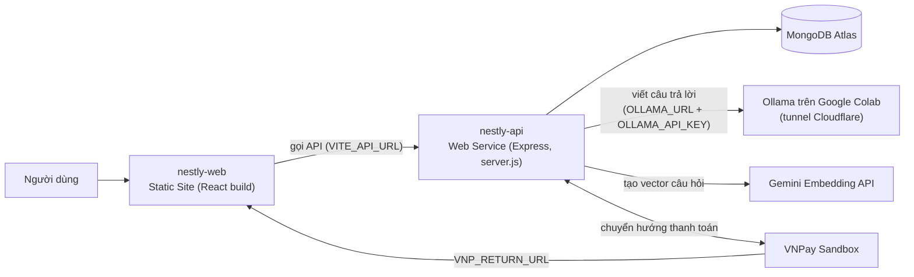

# Hướng dẫn deploy Nestly lên Render

Hệ thống gồm 2 phần, deploy thành 2 dịch vụ trên Render. Cơ sở dữ liệu vẫn dùng MongoDB Atlas như hiện tại.

| Dịch vụ | Loại trên Render | Thư mục | Lệnh build | Lệnh chạy / thư mục xuất bản |
|---|---|---|---|---|
| `nestly-api` | Web Service (Node) | thư mục gốc repo | `npm ci` | `npm start` (= `node server.js`) |
| `nestly-web` | Static Site | `Hotel-RAG-FE` | `npm ci && npm run build` | `dist` |

File `render.yaml` ở thư mục gốc đã khai báo sẵn cả 2 dịch vụ (cách 1 bên dưới).

---

## 0. Chuẩn bị (làm 1 lần)

1. **Đưa code lên GitHub.** Render deploy từ một nhánh. Nên gộp `feature/hoan-thien-gop-y` vào `main` rồi deploy `main`; hoặc chọn thẳng nhánh feature khi tạo dịch vụ.
2. **Tài khoản Render:** đăng ký tại render.com bằng GitHub và cấp quyền truy cập repo.
3. **MongoDB Atlas cho phép Render kết nối:** Atlas → *Network Access* → *Add IP Address* → `0.0.0.0/0` (Allow access from anywhere). Gói Render miễn phí không có IP cố định nên không thể chỉ cho một IP. Bảo mật dựa vào user/mật khẩu trong `MONGO_URI`.
4. **Chuẩn bị giá trị biến môi trường** (xem bảng ở mục 3). Lấy từ file `.env` trên máy, **không** commit file `.env`.

> **Trợ lý AI dùng Ollama trên Google Colab:** Render **không chạy** Ollama, chỉ chạy backend. Backend trên Render gọi sang Ollama đang chạy trong Colab qua URL tunnel Cloudflare, giống hệt khi chạy trên máy. Vì vậy `render.yaml` đặt sẵn `LLM_PROVIDER=ollama`; bạn chỉ cần nhập `OLLAMA_URL` và `OLLAMA_API_KEY` lấy từ ô 6 của notebook (`docs/colab-ollama.md`). `GEMINI_API_KEY` vẫn cần vì bước tạo vector câu hỏi của RAG dùng Gemini.
>
> **Mỗi phiên Colab mới có URL và khóa mới**: mở notebook, chạy lại các ô, rồi vào Render → `nestly-api` → *Environment* → sửa `OLLAMA_URL`, `OLLAMA_API_KEY` → **Save and deploy** (khoảng 1 phút, không cần build lại frontend). Khi Colab đã tắt, trợ lý AI **không báo lỗi** mà vẫn trả danh sách khách sạn phù hợp kèm câu trả lời dựng sẵn; log backend ghi `LLM lỗi, dùng câu trả lời dựng sẵn`.

---

## Cách 1 (khuyên dùng): Blueprint từ `render.yaml`

1. Render Dashboard → **New** → **Blueprint** → chọn repo → chọn nhánh.
2. Render đọc `render.yaml` và hiện 2 dịch vụ `nestly-api`, `nestly-web`. Nhập các biến được hỏi (những biến `sync: false`):
   - `MONGO_URI`, `GEMINI_API_KEY`, `VNP_TMN_CODE`, `VNP_HASH_SECRET`: chép từ `.env`.
   - `VNP_RETURN_URL`, `CORS_ORIGIN`, `VITE_API_URL`: lúc này chưa biết địa chỉ thật → điền tạm theo tên dịch vụ (Render đặt địa chỉ dạng `https://<tên>.onrender.com`; nếu tên đã có người dùng sẽ thêm hậu tố, sửa lại ở bước 4).
     - `VITE_API_URL` = `https://nestly-api.onrender.com/api`
     - `VNP_RETURN_URL` = `https://nestly-web.onrender.com/payment/vnpay-return`
     - `CORS_ORIGIN` = `https://nestly-web.onrender.com`
   - `JWT_SECRET` được Render tự sinh. Nếu muốn giữ đăng nhập cũ hoặc token test thì thay bằng giá trị trong `.env`.
3. Bấm **Apply**. Chờ build xong (backend ~1–2 phút, frontend ~1 phút).
4. Mở trang mỗi dịch vụ, xem địa chỉ thật ở đầu trang. Nếu khác với giá trị đã điền tạm:
   - `nestly-web` → *Environment* → sửa `VITE_API_URL` → **Save, rebuild and deploy** (biến `VITE_` được gắn vào lúc build nên phải build lại).
   - `nestly-api` → *Environment* → sửa `VNP_RETURN_URL`, `CORS_ORIGIN` → **Save and deploy**.

## Cách 2: Tạo tay từng dịch vụ

**Backend**: New → **Web Service** → chọn repo
- Root Directory: *(để trống)* · Runtime: **Node** · Region: **Singapore**
- Build Command: `npm ci` · Start Command: `npm start`
- Instance type: Free · Advanced → Health Check Path: `/api/health`
- Environment: thêm các biến ở bảng mục 3, thêm `NODE_VERSION=22.12.0`.

**Frontend**: New → **Static Site** → chọn repo
- Root Directory: `Hotel-RAG-FE`
- Build Command: `npm ci && npm run build` · Publish Directory: `dist`
- Environment: `VITE_API_URL=https://<backend>.onrender.com/api`, `NODE_VERSION=22.12.0`
- **Redirects/Rewrites** → Add rule: Source `/*`, Destination `/index.html`, Action **Rewrite**. Thiếu bước này thì mở thẳng hoặc F5 ở `/hotels/...` sẽ báo *Not Found*.

---

## 3. Biến môi trường

**Backend (`nestly-api`)**

| Biến | Bắt buộc | Giá trị |
|---|---|---|
| `MONGO_URI` | ✔ | Chuỗi kết nối Atlas (`mongodb+srv://.../Hotel-RAG`) |
| `JWT_SECRET` | ✔ | Chuỗi bí mật dài, ngẫu nhiên |
| `GEMINI_API_KEY` | ✔ | Khóa Gemini API (tạo vector câu hỏi và vector khách sạn khi Admin duyệt) |
| `LLM_PROVIDER` | | `ollama` (Colab) hoặc `gemini` |
| `OLLAMA_URL` | ✔ nếu `ollama` | URL tunnel Colab `https://….trycloudflare.com` (không có `/` ở cuối) |
| `OLLAMA_API_KEY` | ✔ nếu `ollama` | Khóa của phiên Colab hiện tại |
| `OLLAMA_MODEL` | | `dolphin3` |
| `OLLAMA_TIMEOUT_MS` | | `120000` |
| `VNP_TMN_CODE`, `VNP_HASH_SECRET` | ✔ (thanh toán) | Thông tin VNPay sandbox |
| `VNP_URL` | | `https://sandbox.vnpayment.vn/paymentv2/vpcpay.html` |
| `VNP_RETURN_URL` | ✔ | `https://<frontend>.onrender.com/payment/vnpay-return` |
| `CORS_ORIGIN` | khuyên dùng | `https://<frontend>.onrender.com` (nhiều domain thì cách nhau dấu phẩy). Để trống = cho phép mọi nguồn |
| `MAIL_PROVIDER` | | `brevo` (gửi email thật) hoặc `console` (chỉ in link ra log) |
| `BREVO_API_KEY` | ✔ nếu `brevo` | API key Brevo (mục 3b) |
| `MAIL_FROM` | ✔ nếu `brevo` | Email người gửi đã xác minh trong Brevo |
| `MAIL_FROM_NAME` | | `Nestly` |
| `APP_URL` | ✔ | `https://<frontend>.onrender.com`: dùng để tạo link trong email xác nhận / đặt lại mật khẩu |
| `EMAIL_VERIFICATION` | | Không đặt = bắt buộc xác nhận email khi đã cấu hình Brevo. `off` = tắt (đăng ký xong đăng nhập ngay) |
| `NODE_VERSION` | | `22.12.0` |

Không đặt `PORT`: Render tự cấp và `server.js` đã đọc `process.env.PORT`.

### 3b. Gửi email xác nhận / quên mật khẩu (Brevo)

Render bản miễn phí **chặn các cổng SMTP 25, 465, 587**, nên không gửi trực tiếp qua Gmail SMTP được. Backend gửi qua **Brevo HTTP API** (cổng 443), gói miễn phí khoảng 300 email/ngày, không cần tên miền riêng.

1. Đăng ký tài khoản tại brevo.com.
2. **Senders, Domains & Dedicated IPs → Senders → Add a sender**: nhập Gmail của nhóm (vd. `nestly.doan@gmail.com`), mở email Brevo gửi tới Gmail đó và bấm xác nhận.
3. **SMTP & API → API Keys → Generate a new API key** → nếu Brevo hỏi quyền (permissions) của key, chọn **Full access** hoặc ít nhất bật **Transactional emails** (gửi email). Chép key (chỉ hiện 1 lần, dạng `xkeysib-...`).
   Key thiếu quyền này thì log báo `Brevo 403 ... not authorized for resource "transactional.email"` và không email nào được gửi.
   Đồng thời vào **Security → Authorised IPs** tắt chặn IP lạ (IP của Render thay đổi liên tục).
4. Trên Render (`nestly-api` → *Environment*): `MAIL_PROVIDER=brevo`, `BREVO_API_KEY=<key>`, `MAIL_FROM=<Gmail đã xác minh>`, `APP_URL=https://<frontend>.onrender.com` → **Save and deploy**.
5. Thử đăng ký tài khoản mới bằng email thật → nhận email "Xác nhận email đăng ký tài khoản Nestly".

> Gửi từ địa chỉ `@gmail.com` qua dịch vụ khác Gmail dễ bị đưa vào **Spam**; nhắc người dùng xem mục Spam. Chưa cấu hình Brevo (`MAIL_PROVIDER=console`) thì không gửi email, link chỉ in ra *Logs* của `nestly-api`, và việc xác nhận email được tự tắt để người dùng mới vẫn đăng nhập được.

**Frontend (`nestly-web`)**

| Biến | Giá trị |
|---|---|
| `VITE_API_URL` | `https://<backend>.onrender.com/api` (có `/api` ở cuối) |
| `NODE_VERSION` | `22.12.0` (Vite 8 cần Node ≥ 20.19) |

---

## 4. Kiểm tra sau khi deploy

1. Mở `https://<backend>.onrender.com/api/health` → thấy `{"status":"active",...}`.
2. Mở `https://<backend>.onrender.com/api/hotels/provinces` → danh sách 63 tỉnh kèm số khách sạn.
3. Mở trang frontend → trang chủ hiện danh sách khách sạn (nếu trống: kiểm tra `VITE_API_URL` và log backend).
4. Vào thẳng một đường dẫn con, ví dụ `/transfers`, rồi F5 → không bị *Not Found*.
5. Đăng nhập tài khoản demo: tên đăng nhập `mock.customer1` (hoặc `mock.transport1`…), mật khẩu `Nestly@2026` (tài khoản chưa có tên đăng nhập thì gõ email vào ô Tên đăng nhập), đặt phòng hoặc xe → thanh toán VNPay sandbox → quay về trang kết quả trên domain Render.
6. Đăng ký tài khoản mới bằng email thật → nhận email xác nhận → bấm link → đăng nhập. Thử *Quên mật khẩu?* → nhận email → đặt mật khẩu mới.
7. Bật notebook Colab trước, rồi hỏi trợ lý AI một câu ("khách sạn ở Đà Lạt có hồ bơi") → câu trả lời do model viết. Kiểm tra log `nestly-api` không có dòng `LLM lỗi`.

## 5. Lưu ý về gói miễn phí

- **Backend "ngủ" sau 15 phút không có truy cập.** Lần mở đầu tiên sau đó chờ khoảng 30–60 giây. **Trước buổi demo vài phút, mở `/api/health` một lần** để đánh thức.
- Trong lúc ngủ, tác vụ nền (`node-cron`: nhả phòng/xe giữ quá 5 phút, hoàn tất lưu trú) tạm dừng; khi thức dậy, lần chạy đầu tiên sẽ xử lý bù các đơn đã hết hạn, nên dữ liệu không sai.
- Mỗi lần push lên nhánh đã chọn, Render tự build và deploy lại (Auto-Deploy). Muốn tắt: *Settings → Auto-Deploy: No*.
- Static Site miễn phí không ngủ.

## 6. Xử lý lỗi thường gặp

| Hiện tượng | Nguyên nhân / cách sửa |
|---|---|
| Log backend: `MongoServerSelectionError` / không kết nối được DB | Atlas chưa mở `0.0.0.0/0` trong *Network Access*, hoặc sai `MONGO_URI` |
| Log backend: `Cannot find module ...` | Thiếu thư viện trong `package.json` gốc. Thêm vào `dependencies`, chạy `npm install`, commit cả `package-lock.json` |
| Trình duyệt báo lỗi CORS | `CORS_ORIGIN` khác domain frontend (thừa `/` ở cuối, sai `http/https`). Sửa rồi deploy lại backend |
| Trang web gọi `localhost:5000` | Chưa đặt `VITE_API_URL` hoặc đặt sau khi build → *Clear build cache & deploy* frontend |
| Đăng ký xong không nhận được email | Xem mục Spam; log `nestly-api` có `Không gửi được email` → sai `BREVO_API_KEY` hoặc `MAIL_FROM` chưa xác minh trong Brevo. Log có `[Mail - chưa cấu hình gửi thật]` → `MAIL_PROVIDER` chưa là `brevo` |
| Log ghi `Brevo 403 ... not authorized for resource "transactional.email"` | API key không có quyền gửi email giao dịch → tạo key mới với quyền **Transactional emails** (hoặc Full access), thay `BREVO_API_KEY` |
| Log ghi `Brevo 401 ... unrecognised IP` | Brevo chặn IP lạ → *Security → Authorised IPs* → tắt chặn |
| Link trong email trỏ về `localhost` | Chưa đặt `APP_URL` (hoặc `CORS_ORIGIN`) bằng địa chỉ frontend thật |
| F5 ở `/hotels/...` báo Not Found | Thiếu rule Rewrite `/*` → `/index.html` của Static Site |
| VNPay báo "Sai chữ ký" | `VNP_HASH_SECRET` / `VNP_TMN_CODE` sai hoặc thừa khoảng trắng |
| Thanh toán xong quay về `localhost` | `VNP_RETURN_URL` vẫn là địa chỉ máy cá nhân |
| VNPay báo "Giao dịch đã quá thời gian chờ thanh toán" ngay khi mở | (Đã sửa 15/11/2026) Máy chủ Render chạy giờ UTC; backend nay luôn gửi giờ Việt Nam cho VNPay và `server.js` đặt `TZ=Asia/Ho_Chi_Minh`. Nếu vẫn gặp: kiểm tra backend đã deploy bản mới |
| Trợ lý AI chỉ trả câu dựng sẵn, log ghi `LLM lỗi ... fetch failed` | Phiên Colab đã tắt hoặc `OLLAMA_URL` là URL phiên cũ → chạy lại notebook, cập nhật `OLLAMA_URL` |
| Log ghi `Ollama 401` | `OLLAMA_API_KEY` không khớp phiên Colab hiện tại |
| Log ghi `The operation was aborted due to timeout` | Model trên Colab trả lời quá lâu (lần đầu nạp model) → hỏi lại, hoặc tăng `OLLAMA_TIMEOUT_MS` |
| Log ghi `Không tạo được embedding câu hỏi` | `GEMINI_API_KEY` sai / hết quota; AI vẫn chạy nhưng chỉ xếp hạng theo từ khóa |
