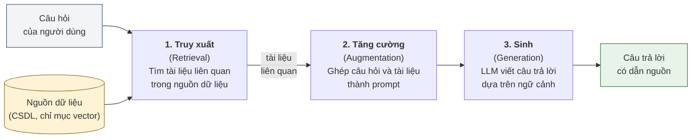
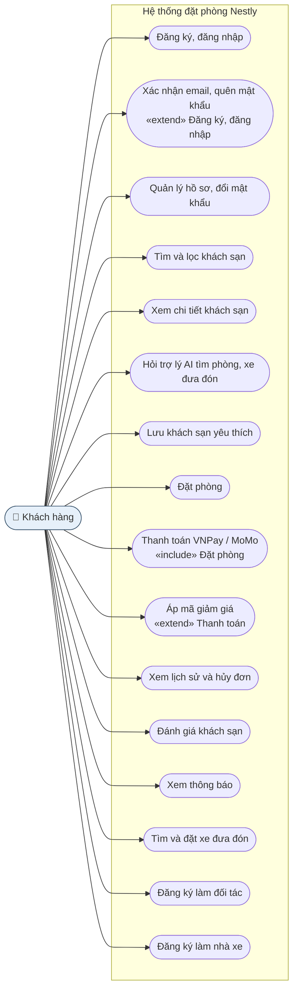
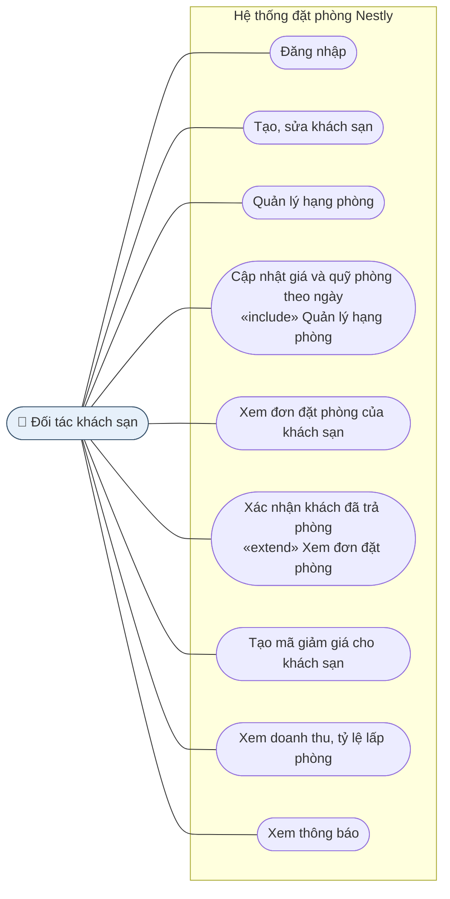
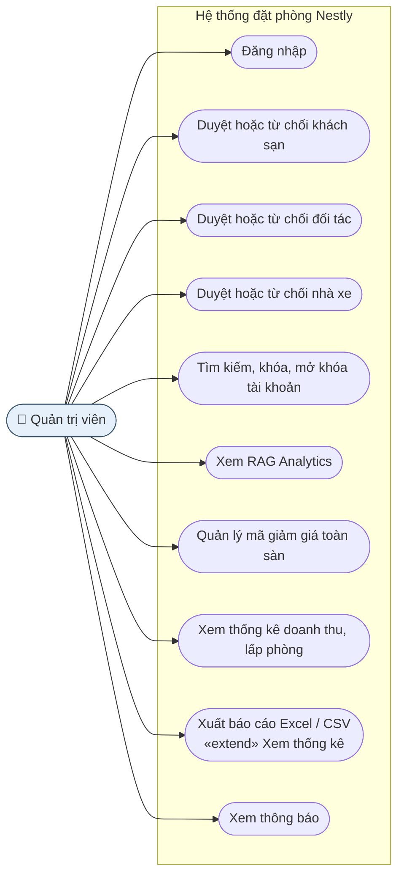
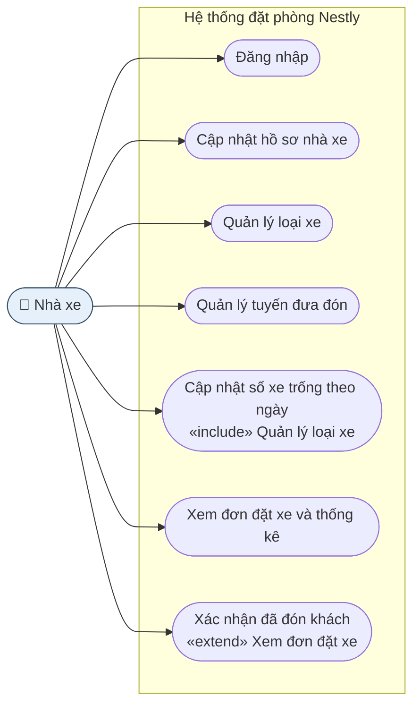

# Mã Mermaid các hình trong báo cáo

Dán từng khối vào https://mermaid.live để xem và xuất ảnh. Các use case được xuất với cấu hình `flowchart: { nodeSpacing: 14, rankSpacing: 90 }` để hình gọn.

## Hình 2.1 – Mô hình RAG

## Hình 3.1 – Use case Khách hàng

## Hình 3.2 – Use case Đối tác khách sạn

## Hình 3.3 – Use case Quản trị viên

## Hình 3.4 – Use case Nhà xe

## Hình 3.5 – ERD

```mermaid
erDiagram
    USER {
        ObjectId _id PK
        string fullName
        string username UK "tên đăng nhập, không bắt buộc (sparse)"
        string email "index; một email có thể có nhiều tài khoản"
        string password "bcrypt hash"
        boolean emailVerified
        string emailVerifyTokenHash "select false"
        date emailVerifyExpires
        string resetPasswordTokenHash "select false"
        date resetPasswordExpires
        date lastVerifyMailAt
        date lastResetMailAt
        string phone
        string role "Customer | Partner | Transport | Admin"
        string partnerApplicationStatus "NotRequested | Pending | Approved | Rejected"
        string status "Active | Locked"
        string address_street
        string address_city
        string address_province "1 trong 63 tỉnh/thành"
        ObjectId_array wishlist FK "-> HOTEL, khách sạn yêu thích"
        date createdAt
        date updatedAt
    }

    HOTEL {
        ObjectId _id PK
        ObjectId partnerId FK "-> USER (Partner)"
        string hotelName
        string description
        string address_street
        string address_city "quận/huyện/TP thuộc tỉnh"
        string address_province "1 trong 63 tỉnh/thành (bắt buộc)"
        GeoJSON coordinates "Point [lng, lat], index 2dsphere"
        number rating "trung bình từ REVIEW"
        number reviewCount
        string_array amenities
        string_array images
        number_array embedding "vector 1024 chiều (bge-m3, Ollama)"
        string status "Pending | Approved | Rejected"
        string rejectionReason
        date reviewedAt
        date createdAt
        date updatedAt
    }

    ROOM_TYPE {
        ObjectId _id PK
        ObjectId hotelId FK "-> HOTEL"
        string title
        string description
        number basePrice
        number maxAdults
        number maxChildren
        number totalQuantity
        string_array amenities
        string_array images
        boolean isActive "false = khóa bảo trì"
        date createdAt
        date updatedAt
    }

    ROOM_INVENTORY {
        ObjectId _id PK
        ObjectId roomTypeId FK "-> ROOM_TYPE, unique (roomTypeId, date)"
        date date "00:00 UTC của từng đêm"
        number availableRooms "min 0"
        number dynamicPrice "null = dùng basePrice"
        date createdAt
        date updatedAt
    }

    BOOKING {
        ObjectId _id PK
        ObjectId customerId FK "-> USER"
        ObjectId hotelId FK "-> HOTEL"
        date checkInDate
        date checkOutDate
        date expiresAt "hạn giữ chỗ 5 phút (Pending)"
        number subtotalAmount "tạm tính trước giảm giá"
        number totalAmount "số tiền phải trả"
        ObjectId coupon_couponId FK "-> COUPON (mã đang áp)"
        string coupon_code
        number coupon_discountAmount
        string specialRequests
        string idempotencyKey "unique (customerId, idempotencyKey)"
        string bookingStatus "Pending | Confirmed | Canceled | Completed"
        date createdAt
        date updatedAt
    }

    BOOKING_DETAIL {
        ObjectId _id PK
        ObjectId roomTypeId FK "-> ROOM_TYPE"
        number quantity "min 1"
        number unitPrice "giá chốt lúc đặt"
        number totalNights
    }

    PAYMENT {
        ObjectId _id PK
        ObjectId bookingId FK "-> BOOKING (đơn phòng)"
        ObjectId transferBookingId FK "-> TRANSFER_BOOKING (đơn xe)"
        string paymentMethod "VNPay | Momo | Cash | Demo"
        number amount
        string paymentStatus "Pending | Success | Failed"
        date paymentDate
        string transactionId "mã giao dịch VNPay / MoMo"
        date createdAt
        date updatedAt
    }

    REVIEW {
        ObjectId _id PK
        ObjectId customerId FK "-> USER"
        ObjectId hotelId FK "-> HOTEL"
        ObjectId bookingId FK, UK "-> BOOKING, mỗi đơn 1 đánh giá"
        number rating "1 - 5"
        string comment
        date createdAt
        date updatedAt
    }

    RAG_LOG {
        ObjectId _id PK
        string userQuery
        mixed constraints "ràng buộc cứng: thành phố, tỉnh, ngày, ý định đặt xe..."
        ObjectId_array retrievedHotelIds FK "-> HOTEL"
        ObjectId_array retrievedContextIds FK "-> ROOM_TYPE, theo thứ tự xếp hạng"
        ObjectId_array retrievedTransferRouteIds FK "-> TRANSFER_ROUTE, xe đã gợi ý [Xn]"
        ObjectId_array goldenContextIds FK "-> ROOM_TYPE, nhãn Golden"
        string llmResponse
        string answerSource "llm | template | guardrail"
        string llmModel "vd. ollama:dolphin3"
        mixed pipelineStats "catalog, afterHardFilters, afterAvailability, transferResults"
        number latencyMs
        number metrics_hitRate
        number metrics_recall
        number metrics_precision
        number metrics_groundedness "1 = bám sát, 0 = bịa"
        number metrics_citationCorrectness
        date createdAt
    }

    TRANSPORT_COMPANY {
        ObjectId _id PK
        ObjectId ownerId FK, UK "-> USER (Transport)"
        string companyName
        string phone
        string licenseNumber "giấy phép KD vận tải"
        string description
        string_array serviceProvinces "thuộc danh mục 63 tỉnh"
        string status "Pending | Approved | Rejected"
        string rejectionReason
        date reviewedAt
        date createdAt
        date updatedAt
    }

    VEHICLE_TYPE {
        ObjectId _id PK
        ObjectId companyId FK "-> TRANSPORT_COMPANY"
        string name
        number seats
        number luggage
        number totalVehicles
        string_array amenities
        string_array images
        boolean isActive
        date createdAt
        date updatedAt
    }

    TRANSFER_ROUTE {
        ObjectId _id PK
        ObjectId vehicleTypeId FK "-> VEHICLE_TYPE"
        ObjectId companyId FK "-> TRANSPORT_COMPANY"
        string province "1 trong 63 tỉnh/thành"
        string fromPlace
        string toPlace
        number price "VNĐ / xe / chuyến"
        number durationMin
        boolean isActive
        date createdAt
        date updatedAt
    }

    VEHICLE_INVENTORY {
        ObjectId _id PK
        ObjectId vehicleTypeId FK "-> VEHICLE_TYPE, unique (vehicleTypeId, date)"
        date date "00:00 UTC"
        number availableVehicles "min 0"
        date createdAt
        date updatedAt
    }

    TRANSFER_BOOKING {
        ObjectId _id PK
        ObjectId customerId FK "-> USER"
        ObjectId companyId FK "-> TRANSPORT_COMPANY"
        ObjectId routeId FK "-> TRANSFER_ROUTE"
        ObjectId vehicleTypeId FK "-> VEHICLE_TYPE"
        ObjectId hotelBookingId FK "-> BOOKING (tùy chọn)"
        date pickupTime
        date serviceDate "00:00 UTC ngày đón (giờ VN)"
        number passengers
        number vehicles
        string flightNumber
        string contactPhone
        string note
        number unitPrice
        number subtotalAmount "tạm tính trước giảm giá"
        number totalAmount "số tiền phải trả"
        ObjectId coupon_couponId FK "-> COUPON (mã đang áp)"
        string coupon_code
        number coupon_discountAmount
        string status "Pending | Confirmed | Canceled | Completed"
        date expiresAt "giữ xe 5 phút"
        string idempotencyKey "unique (customerId, idempotencyKey)"
        date createdAt
        date updatedAt
    }

    COUPON {
        ObjectId _id PK
        string code UK "chữ in hoa, 3-30 ký tự"
        string description
        string discountType "percent | amount"
        number value "% hoặc số tiền"
        number maxDiscount "giảm tối đa (mã %)"
        number minOrderAmount
        string appliesTo "hotel | transfer | all"
        ObjectId hotelId FK "-> HOTEL (mã của Partner)"
        ObjectId createdBy FK "-> USER"
        string ownerRole "Admin | Partner"
        date startsAt
        date expiresAt
        number usageLimit "tổng lượt"
        number usedCount "lượt đang giữ / đã dùng"
        number perUserLimit
        boolean isActive
        date createdAt
        date updatedAt
    }

    NOTIFICATION {
        ObjectId _id PK
        ObjectId userId FK "-> USER (người nhận)"
        string type "order_new | order_paid | order_canceled | order_expired | application_*"
        string title
        string message
        string link "đường dẫn khi bấm"
        date readAt "null = chưa đọc"
        date createdAt "TTL: tự xóa sau 90 ngày"
        date updatedAt
    }

    USER ||--o{ HOTEL : "sở hữu (Partner)"
    USER ||--o{ BOOKING : "đặt phòng"
    USER ||--o{ REVIEW : "viết"
    HOTEL ||--o{ ROOM_TYPE : "có"
    HOTEL ||--o{ BOOKING : "nhận"
    HOTEL ||--o{ REVIEW : "được đánh giá"
    ROOM_TYPE ||--o{ ROOM_INVENTORY : "quỹ phòng theo ngày"
    BOOKING ||--|{ BOOKING_DETAIL : "gồm (nhúng trong Booking)"
    ROOM_TYPE ||--o{ BOOKING_DETAIL : "được đặt"
    BOOKING ||--o{ PAYMENT : "thanh toán"
    BOOKING ||--o| REVIEW : "được đánh giá (tối đa 1)"
    RAG_LOG }o--o{ HOTEL : "truy xuất"
    RAG_LOG }o--o{ ROOM_TYPE : "ngữ cảnh / nhãn Golden"
    USER ||--o| TRANSPORT_COMPANY : "sở hữu (Transport)"
    TRANSPORT_COMPANY ||--o{ VEHICLE_TYPE : "có"
    TRANSPORT_COMPANY ||--o{ TRANSFER_ROUTE : "khai thác"
    VEHICLE_TYPE ||--o{ TRANSFER_ROUTE : "chạy tuyến"
    VEHICLE_TYPE ||--o{ VEHICLE_INVENTORY : "số xe trống theo ngày"
    USER ||--o{ TRANSFER_BOOKING : "đặt xe"
    TRANSFER_ROUTE ||--o{ TRANSFER_BOOKING : "được đặt"
    TRANSPORT_COMPANY ||--o{ TRANSFER_BOOKING : "nhận đơn"
    VEHICLE_TYPE ||--o{ TRANSFER_BOOKING : "được chọn"
    BOOKING |o--o{ TRANSFER_BOOKING : "đi kèm (tùy chọn)"
    TRANSFER_BOOKING ||--o{ PAYMENT : "thanh toán"
    USER }o--o{ HOTEL : "yêu thích (wishlist)"
    USER ||--o{ COUPON : "tạo (Admin / Partner)"
    HOTEL |o--o{ COUPON : "mã riêng của khách sạn"
    COUPON |o--o{ BOOKING : "áp vào đơn phòng"
    COUPON |o--o{ TRANSFER_BOOKING : "áp vào đơn xe"
    USER ||--o{ NOTIFICATION : "nhận"
    RAG_LOG }o--o{ TRANSFER_ROUTE : "gợi ý xe"
```

