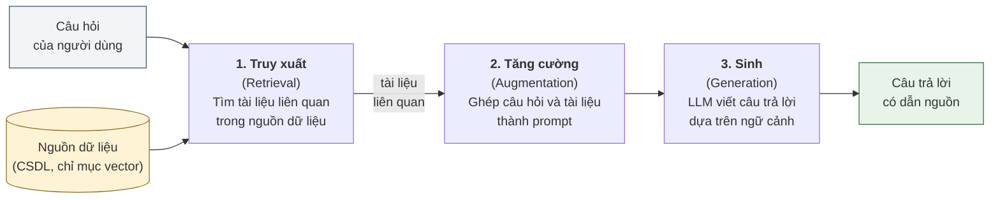
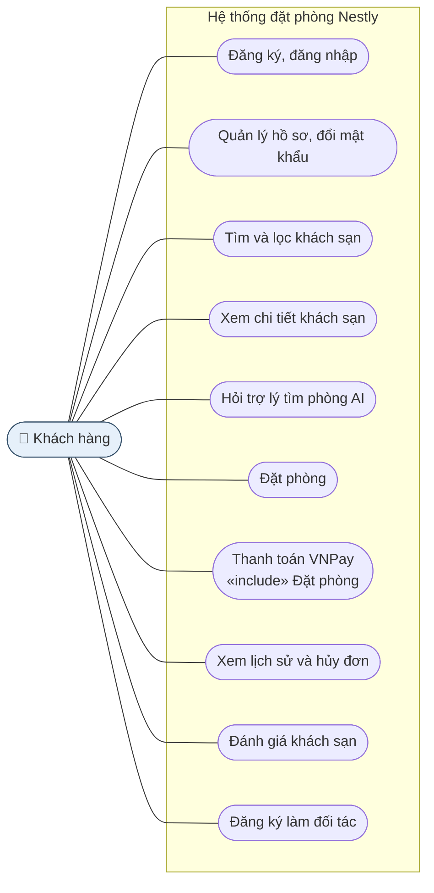
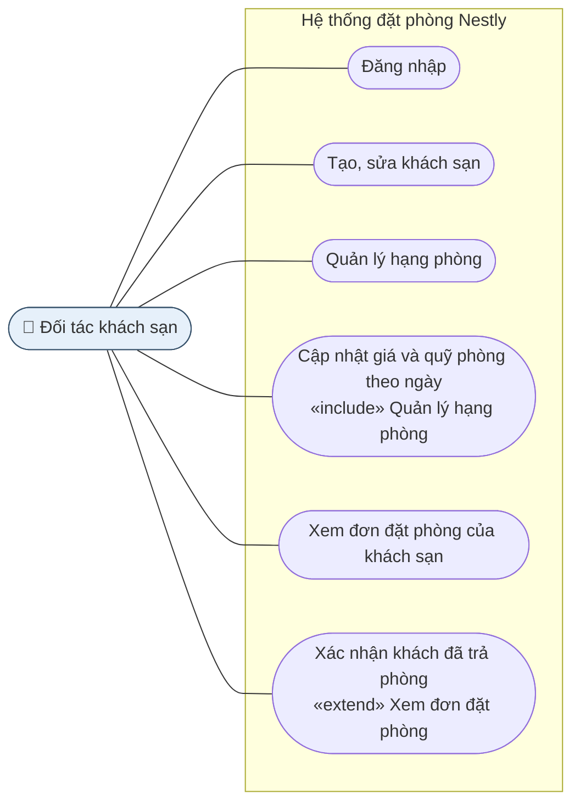
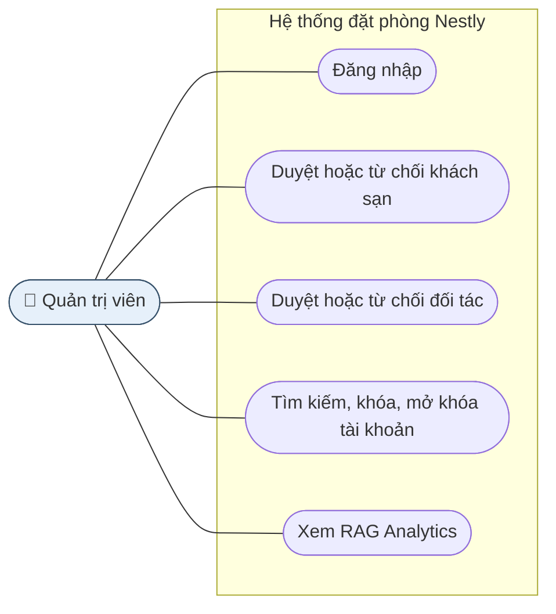
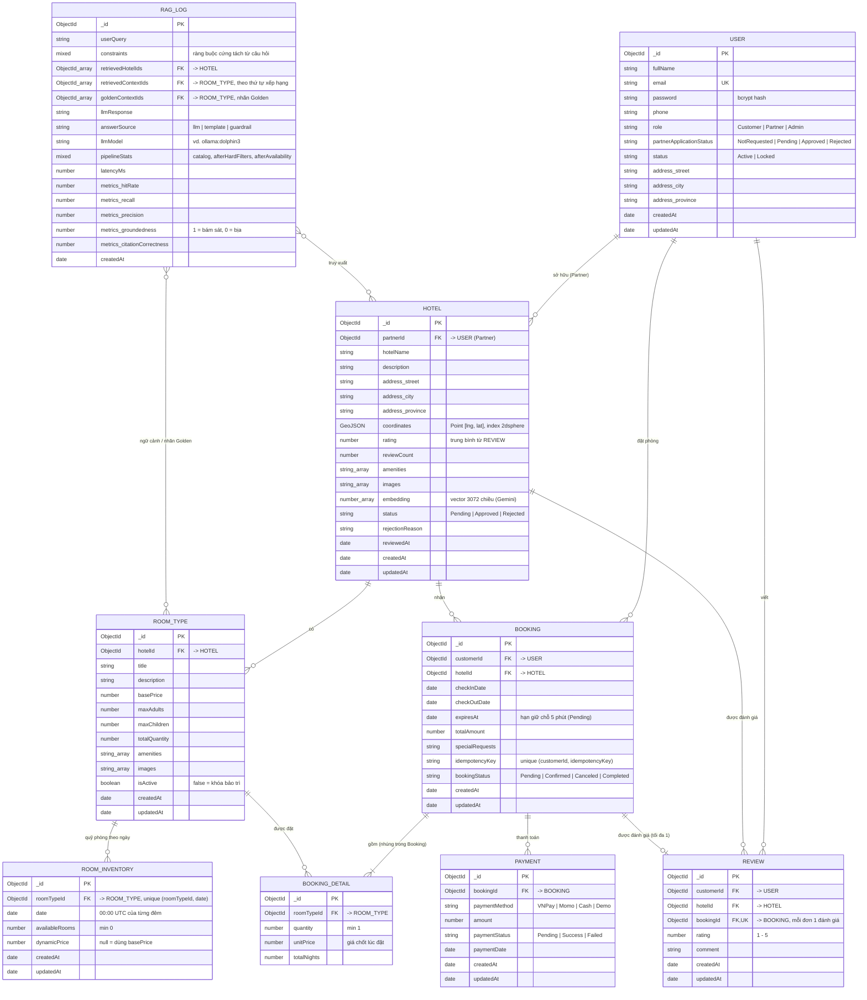

# Mã Mermaid các hình trong báo cáo

Dán từng khối vào https://mermaid.live để xem và xuất ảnh.

## Hình 2.1 – Mô hình RAG

## Hình 3.1 – Use case Khách hàng

## Hình 3.2 – Use case Đối tác khách sạn

## Hình 3.3 – Use case Quản trị viên

## Hình 3.4 – ERD

